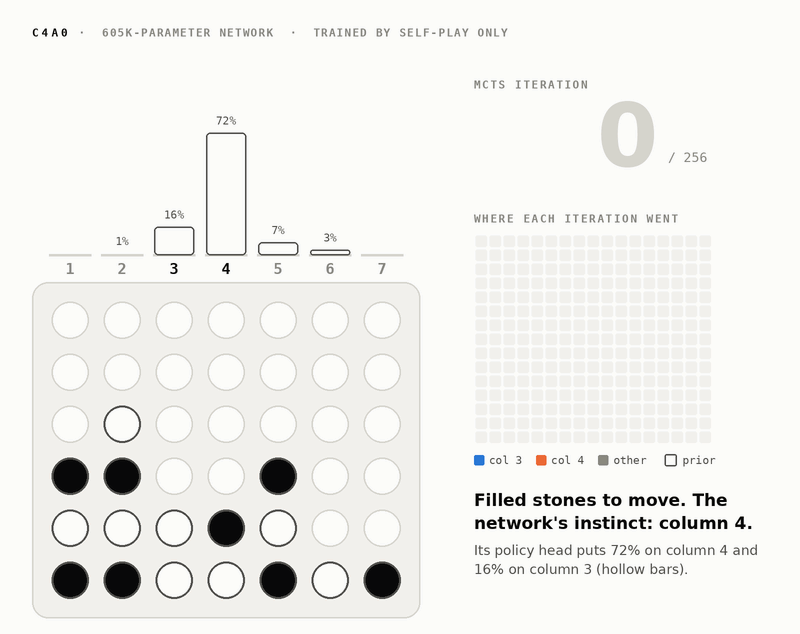
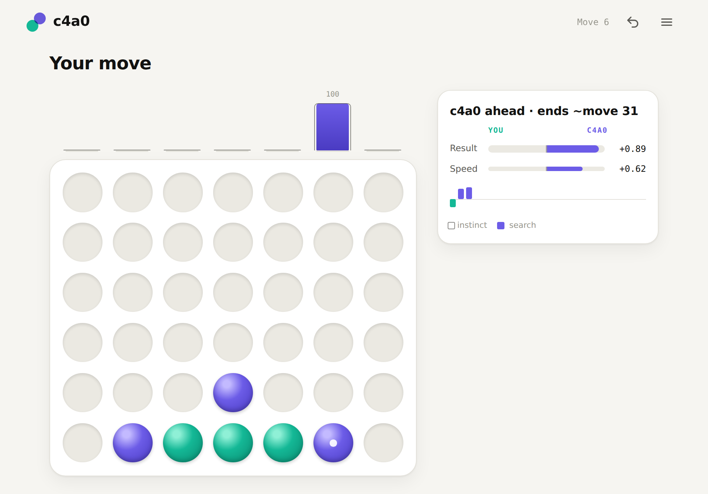
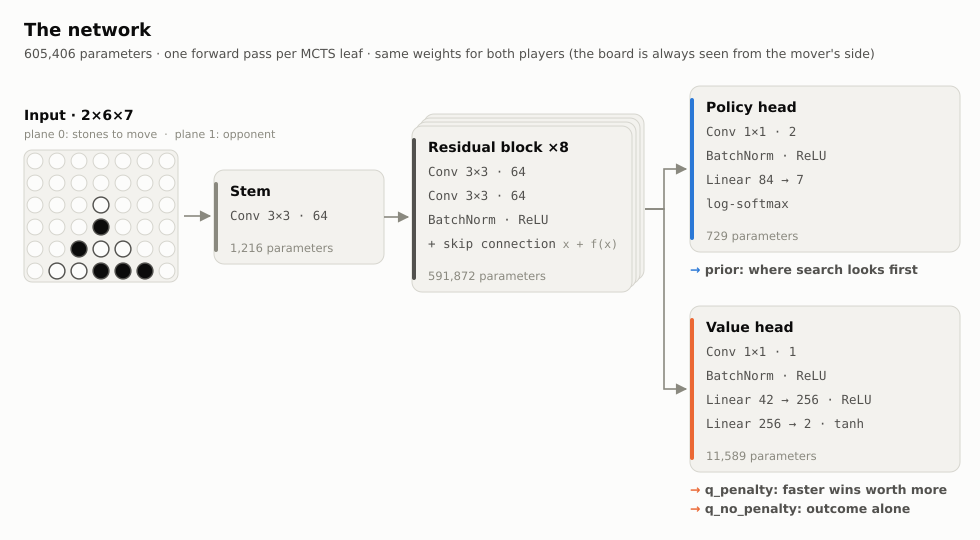

# c4a0: Connect Four AlphaZero


<p align="center">
  <picture>
    <source media="(prefers-color-scheme: dark)" srcset="images/hero-dark.gif">
    
  </picture>
</p>

**A 605K-parameter network that learns near-perfect Connect Four strictly through self-play.** No human games, no opening book, no solver in the training loop: it starts from random weights, plays itself, and learns from its own search. After 6 hours on one GPU it picks the solver-optimal move (the fastest win, or the slowest loss) in 97% of held-out positions, and keeps the game result (a won position stays won, a drawn one stays drawn) in 99% of them.

**[Play it in your browser at c4a0.advait.lol.](https://c4a0.advait.lol)** The real network runs on your GPU through WebGPU, searching each move with the exact agent from the results table below.

The animation above is the real final network on a real position. Its first instinct, column 4 at 72%, loses. Search tests that instinct one iteration at a time, moves its lead to column 3 at iteration 73, and ends with 83% of its visits there. Column 3 is the only winning move. Training then teaches the network to put its prior where the search ended up.

## Results

<picture>
  <source media="(prefers-color-scheme: dark)" srcset="images/training-progress-dark.svg">
  
</picture>

Every generation is scored on about 2,000 held-out positions, each labeled move by move by a perfect solver. The network never sees those labels: self-play may wander into the same positions, but it only ever learns from its own search. The untrained network already gets 87% with search, because search alone finds short tactics; the network alone starts at 21%. Training is what closes the long-range gap.

The final agent searches with mirror averaging and a 10-ply exact leaf search (both described below):

| Held-out split | Picks the optimal move, MCTS-256 | MCTS-2048 | Keeps the result, MCTS-256 | MCTS-2048 |
|---|---|---|---|---|
| dev | 96.99% | 97.44% | 98.58% | 99.19% |
| test | 96.84% | 97.15% | **99.01%** | 98.88% |

The test split played no part in any decision. Most of the remaining misses are in the first 11 moves, where the deciding line is 30 or more plies deep. [What we learned trying to make self-play converge](docs/experiments.md) has every hypothesis tested on the way here, including the ones that failed.

## Try it

**[Play at c4a0.advait.lol.](https://c4a0.advait.lol)** Nothing to install: the network runs on your GPU through WebGPU, and every move is the agent from the results table. The bars over the board show the network's first instinct and where the search went; the card beside it shows c4a0's two values for the position.

<picture>
  <source media="(prefers-color-scheme: dark)" srcset="images/web-dark.png">
  
</picture>

To run it from source, install [mise](https://mise.jdx.dev/getting-started.html), which brings Rust, uv and Python 3.11 for the project. Rust also needs the system C linker `cc` (on Debian or Ubuntu, `sudo apt install build-essential`; on macOS, `xcode-select --install`). Then, from the repository root:

```sh
mise trust
mise install
mise web        # http://localhost:8000
```

The first run builds the Rust extension, the WebAssembly search and the Python environment; there is no separate build step.

To train your own from scratch (a GPU is strongly recommended; on Linux the locked PyTorch build includes CUDA):

```sh
mise train                      # resumes from training/ if it exists
mise report training            # score curve per generation
```

`mise train:smoke` checks the whole loop on a CPU in seconds. [docs/development.md](docs/development.md) covers the tooling, every training option, and the remaining tasks.

## How it works

Rust owns the game, the search and multi-threaded self-play. A PyTorch network, called from Rust through [PyO3](https://pyo3.rs), supplies the search's move priors and position values. Each generation:

1. **Self-play.** 2,048 games, 256 MCTS iterations per move. Half start from a random opening of up to 12 moves so the network sees more than the lines it already likes. Rust batches positions from every game into one network call.
2. **Train.** A copy of the network learns from the last 8 generations' games for 8 epochs while its learning rate anneals to 1%. The policy target is the search's visit distribution and the value target is the search's own root value.
3. **Score and publish.** The new network is scored on the held-out dev suite, then becomes the next generation's player.

### The network

<picture>
  <source media="(prefers-color-scheme: dark)" srcset="images/architecture-dark.svg">
  
</picture>

- **Input, 2×6×7.** Two planes: the stones of the player to move, and the opponent's. The board is always shown from the mover's side, so one set of weights plays both colors.
- **Stem, 3×3 convolution to 64 channels.** Lifts each cell into a 64-number feature vector that already knows its immediate neighbors.
- **Residual blocks, ×8.** Each block applies two 3×3 convolutions, BatchNorm and ReLU, and adds the result back onto its input. Every block widens what a cell can see by two cells in each direction, so from the third block on every cell's features depend on the whole board. The skip connections keep an 8-block stack trainable. The trunk holds 98% of the parameters.
- **Policy head.** A 1×1 convolution squeezes the trunk to 2 channels, then a linear layer maps those 84 numbers to 7 column logits. The softmax of those logits is the prior: where search looks first.
- **Value head.** A 1×1 convolution squeezes the trunk to 1 channel, then two linear layers (42 → 256 → 2) and a tanh produce two values in [-1, 1].

`scripts/plot_architecture.py` draws the diagram from the code, so its parameter counts cannot drift.

### The value function

The value head predicts two numbers for the player to move, because the network has two jobs.

- **`q_no_penalty`: who is winning.** The expected result with no regard for when it happens: +1 for a win, 0 for a draw, −1 for a loss. It answers the plain question and is what the value accuracy in each generation's report is measured on.
- **`q_penalty`: how good the win is.** The same result, shrunk by 0.01 for every ply the game lasts: a win that ends at ply 15 is worth 0.85, one that ends at ply 41 only 0.59, and losses mirror this (−0.85 for a quick loss, −0.59 for a long one). Search steers by this value, so among winning moves it prefers the fastest win, and when every move loses it fights for the longest game.

Without the penalty every winning move looks equally good, and search has no reason to finish a won game. With only the penalty, a far-off certain win and a close uncertain position can look alike. Keeping both separates "is it won?" from "how soon?". Both are trained on the search's root values, and once the search proves a position (below) those targets are exact.

### Search

`rust/src/mcts.rs` runs PUCT search: each child is scored by its mean `q_penalty` plus `c × prior × √N_parent / (1 + n)`, with Dirichlet noise at the root during self-play only. Three things make it sharper than plain MCTS:

- **MCTS-Solver.** A finished game is proven; a position with a move into a proven loss for the opponent is a proven win; a position whose moves are all proven takes the best of them. Proven nodes back up exact values, and a proven root plays its proven-best moves. This uses only the rules.
- **Leaf search (optional, `--leaf-minimax-depth`).** Before a leaf goes to the network, an exact alpha-beta search to a fixed depth proves any forced win or loss inside that horizon, with its exact distance. At depth 10 every position from ply 18 on is essentially perfect.
- **Mirror averaging (optional, `--mirror-inference`).** Connect Four is left-right symmetric, so each network call can be averaged with its mirror image.

### The judge

The evaluation suites in `src/c4a0/suite/v1/` are labeled by `rust/src/native_solver/`, a clean-room Rust solver that scores every move of a position exactly (validated against [Pascal Pons's solver](https://github.com/PascalPons/connect4) on 228,041 positions; [report](docs/native-solver.md)). A position and its mirror image always land in the same split, and the supervised experiments in `docs/experiments.md` train only on positions from a third, train split. Self-play training never calls the solver and never reads a label.
