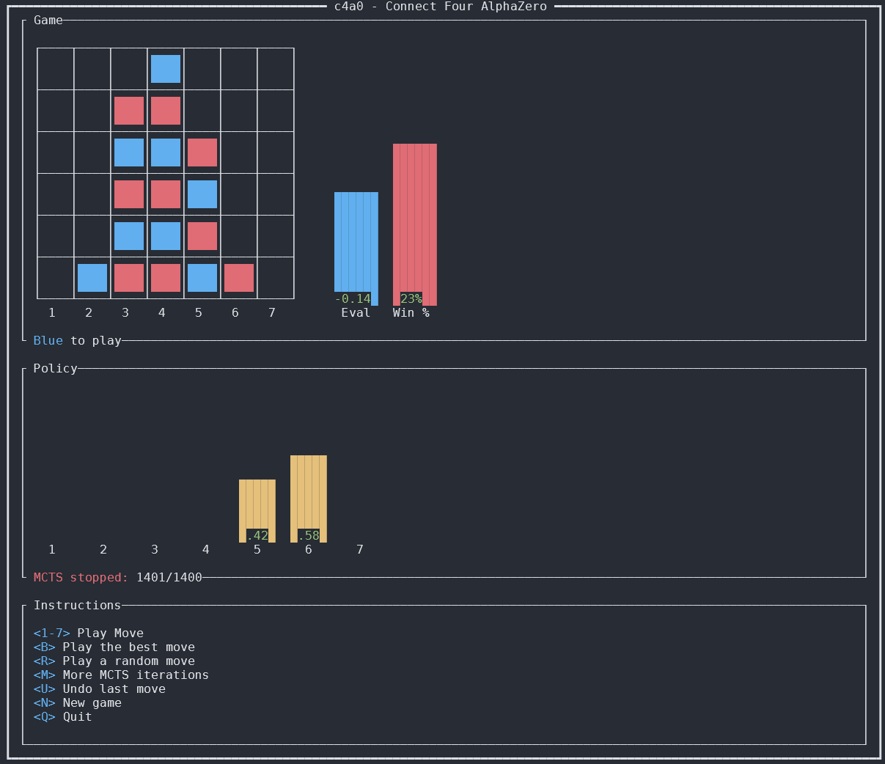
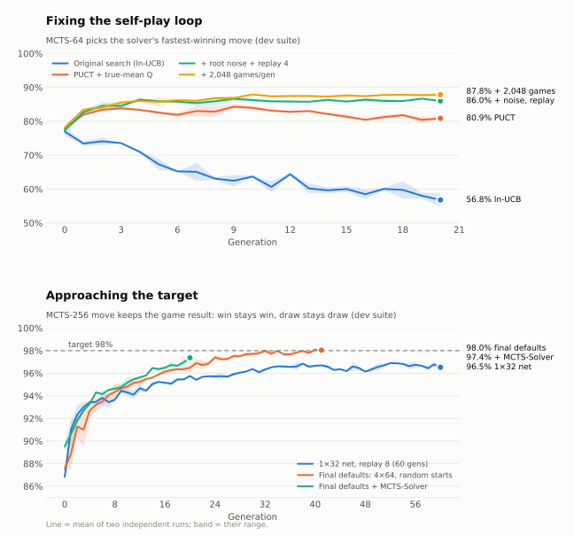

# c4a0: Connect Four AlphaZero


An AlphaZero-style Connect Four engine that learns entirely from self-play, measured move by move against a perfect solver.

Rust runs the game, Monte Carlo Tree Search (MCTS) and multi-threaded self-play. A PyTorch network, called from Rust through [PyO3](https://pyo3.rs), estimates move priors and position values for the search.



## Training progress

<picture>
  <source media="(prefers-color-scheme: dark)" srcset="images/training-progress-dark.svg">
  
</picture>

Every generation's saved model is scored on a fixed, solver-labeled suite of positions it never trains on. The headline metric asks whether the move MCTS chooses keeps the game result: a won position stays won and a drawn one stays drawn. The target is 98%.

| Configuration | Generations | MCTS-256 move keeps the result | MCTS-64 picks the solver's best move |
|---|---|---|---|
| Original search, 1x32 network | 20 | not measured | 57% (and falling) |
| PUCT search | 20 | not measured | 81% |
| + root noise, replay 4, 2,048 games | 20 | not measured | 88% |
| + replay 8, 60 generations | 60 | 96.5% | 89% |
| + 4x64 network, search-value targets | 19-20 | 96.9% | 93% |

Each row is the mean of two independent runs. The full record of what was tried, what helped, what hurt and what is still open is in [what we learned trying to make self-play converge](docs/experiments.md).

## Install

You need two things on the machine:

- [mise](https://mise.jdx.dev/getting-started.html), which installs Rust, uv and Python 3.11 for the project.
- A C toolchain (`cc`), which the Rust build links with. On Debian or Ubuntu, run `sudo apt install build-essential`.

Then, from the repository root:

```sh
mise trust
mise install
```

Every task below builds the Rust extension and the Python environment the first time it runs, so there is no separate build step. On Linux the locked PyTorch build includes CUDA, and training uses an NVIDIA GPU when one is present.

## Play

To play in the terminal against plain MCTS, with no trained network:

```sh
mise run play -- --model uniform
```

To play against your latest trained generation:

```sh
mise run play
```

## Train

To train with the best configuration found so far:

```sh
mise run train
```

Generations are written to `training/`, one directory per generation, each with `model.pkl`, `games.pkl` and `metadata.json`. Rerunning the command resumes from the latest generation. A GPU is strongly recommended: one generation takes several minutes on an RTX 3090 and much longer on a CPU.

Any `train` option can be passed after `--`. For example, to stop after 10 generations:

```sh
mise run train -- --max-gens 10
```

To check that everything works end to end on a CPU, run the tiny smoke configuration. It takes a few seconds once the project is built:

```sh
mise run train:smoke
```

Run `uv run python src/c4a0/main.py train --help` for every option and its default.

## Measure progress

To print the score curve of a training run:

```sh
mise run report -- training
```

The report shows, per generation, the share of MCTS-256 moves that keep the game result, the strict best-move share, and the opening plies where most errors remain. Point it at a directory of several runs (for example `runs/`, with one base directory per run) to compare arms side by side.

To rescore saved generations, for example after adding an MCTS budget:

```sh
mise run eval -- --base-dir training --mcts-iterations 1024
```

To redraw the progress graph above from `docs/data/training-progress.json`:

```sh
mise run plot
```

## How it works

### Game and search

`rust/src/c4r.rs` holds the bitboard position and every Connect Four rule. `rust/src/mcts.rs` runs PUCT search: each child is scored by its mean value plus `c * prior * sqrt(N_parent) / (1 + n)`, with root Dirichlet noise mixed in during self-play only. `rust/src/self_play.rs` plays thousands of games in parallel. It batches positions from every game into one network call, caches evaluations within a generation, and samples moves from the visit counts.

### Network and training loop

`src/c4a0/nn.py` defines a residual CNN with a policy head and two value heads. `src/c4a0/training.py` runs the generation loop:

1. Play self-play games with the current network.
2. Train a copy of the network on the last 8 generations' games. The policy target is the MCTS visit distribution and the value target is the search's own root value.
3. Save the child and score it on the dev suite before publishing its metadata.

Half of the self-play games start from a random opening of up to 20 moves, so the network sees more than the lines it already likes. Every setting is a field of `GenConfig` and a `train` option.

### Evaluation

`src/c4a0/suite/v1/` holds a committed dev and test suite of about 2,400 positions each. Positions are sampled by random walks across plies 2 to 41, and every move is labeled by [Pascal Pons's solver](https://github.com/PascalPons/connect4). A position and its mirror image always land in the same split. `src/c4a0/evaluation.py` scores the raw network and MCTS at fixed budgets, by ply bucket, and stores the result in each generation's metadata, so evaluation needs no solver at run time.

## Rebuild the suite or label positions

Training and evaluation do not need the solver. You only need it to rebuild the committed suite or to label positions for the supervised ceiling (`main.py label` and `main.py ceiling`). Build it in `solver/`:

```sh
git clone https://github.com/PascalPons/connect4.git solver
make -C solver
curl -L -o solver/7x6.book https://github.com/PascalPons/connect4/releases/download/book/7x6.book
mise run suite:build
```

A clean-room Rust solver on the `feat/rust-solver` branch agrees with Pons on every one of 228,041 compared positions. It is not wired in yet. See the open items in [docs/experiments.md](docs/experiments.md).

## Develop

```sh
mise run check
```

`check` runs Ruff (lint and format), ty, the Rust tests and the Python tests. CI runs `mise run ci`, which adds the smoke training run. See [docs/development.md](docs/development.md) for the tooling details.
